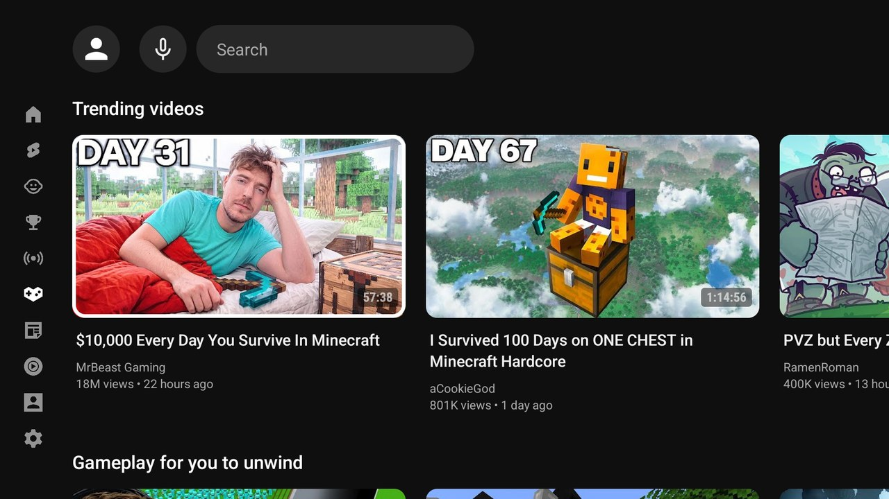
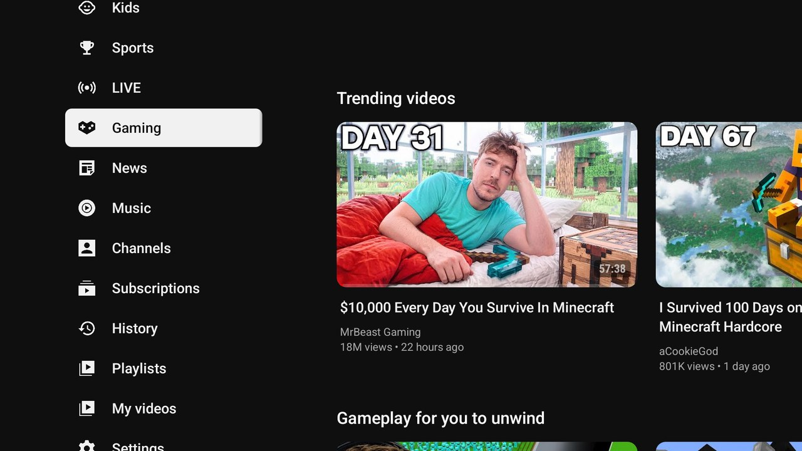
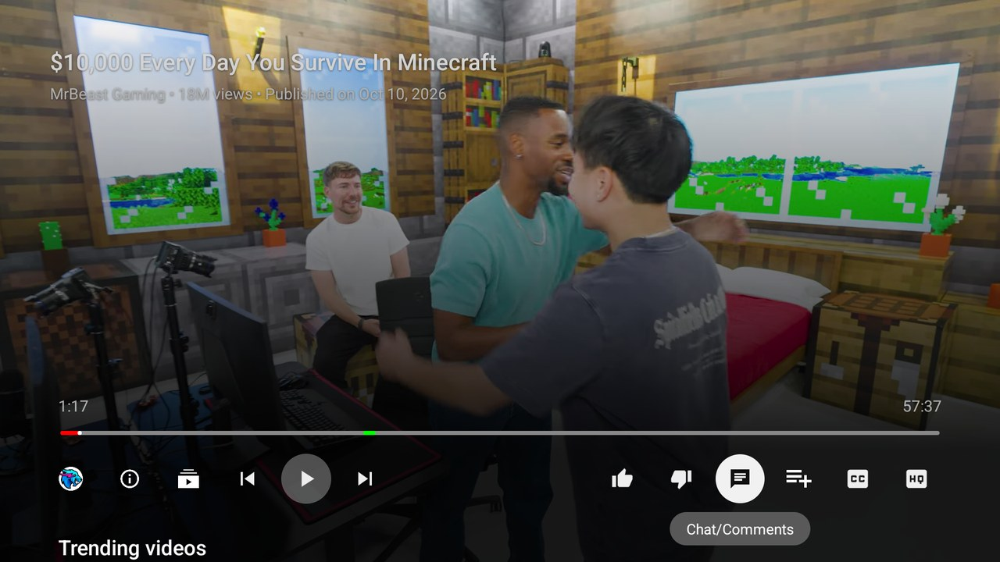
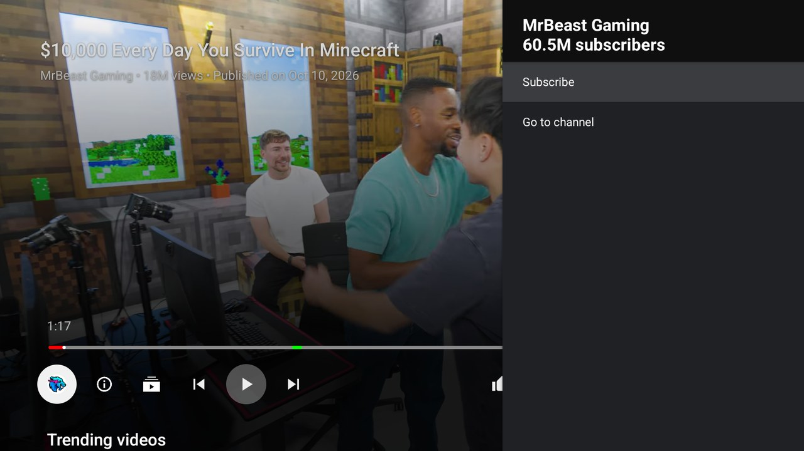
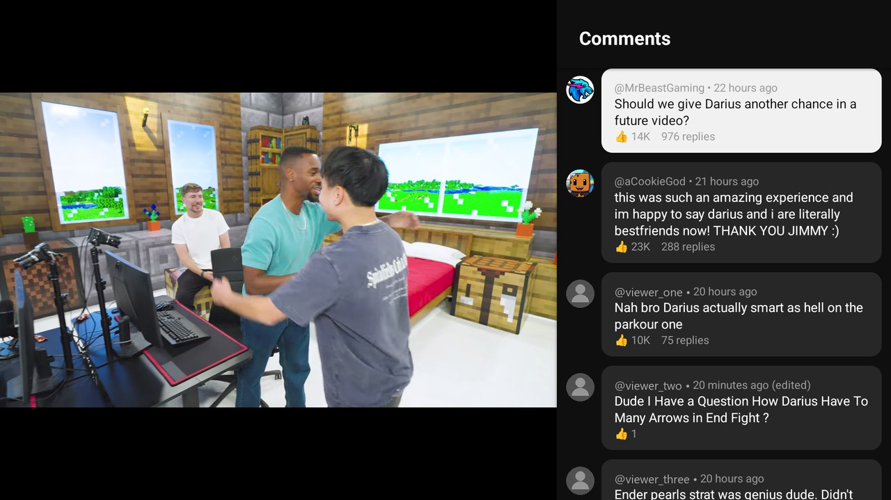
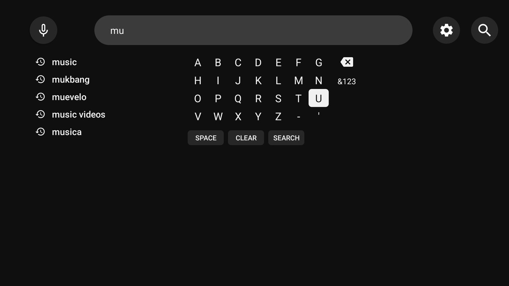
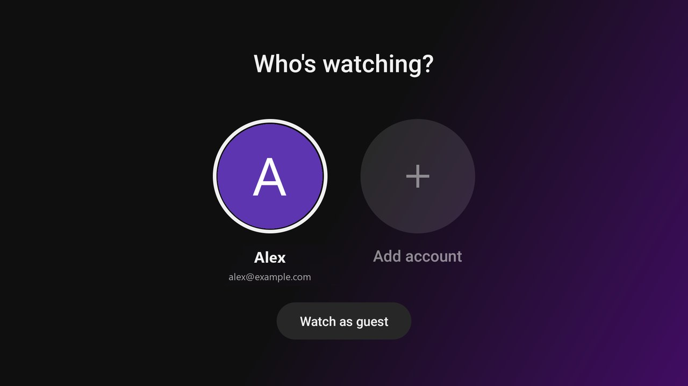

# SmartTube (Inge's build)

**English** | [Nederlands](README.nl.md)

A modified version of [SmartTube](https://github.com/yuliskov/SmartTube) by yuliskov, under the same MIT license.
This build looks more like the official YouTube app for TV:

- cleaner tiles without zoom on focus, navigation strip and menu in YouTube style
- simpler player bar, channel panel in the player, tidier comments
- "Who's watching?" profile picker with a background colour taken from the profile picture
- search screen with letter grid and search history, like the YouTube app
- faster startup (the security token is stored and created ahead of time)
- updates through the [releases](https://github.com/ingesluis1/SmartTube/releases) of this repository

## Screenshots

| | |
|---|---|
|  Home with tiles |  Menu |
|  Player bar |  Channel panel in the player |
|  Comments |  Search screen |

 Who's watching? (example profile)

All changes are marked in the code with `MOD (Inge)`.

**Install:** download the latest apk under Releases (`armeabi-v7a` for most TVs) and install it with the Downloader app.

**Build it yourself:** JDK 17, then `./gradlew assembleStstableDebug`. For a release build you need your own `keystore.properties` with a signing key (not included in this repository).

**Note:** I have only tested this version on an Android TV emulator and on a Philips 65OLED810 (Google TV). It may behave differently on other TVs or boxes. I made this for myself and don't offer support: if you run into a bug, feel free to fork the repository and fix it yourself. Please don't report problems with this version to the original SmartTube developer either.

More about the original app, such as all features and supported devices, can be found at [yuliskov/SmartTube](https://github.com/yuliskov/SmartTube).
